

<b>العربية</b> · <a href="#english">English</a>

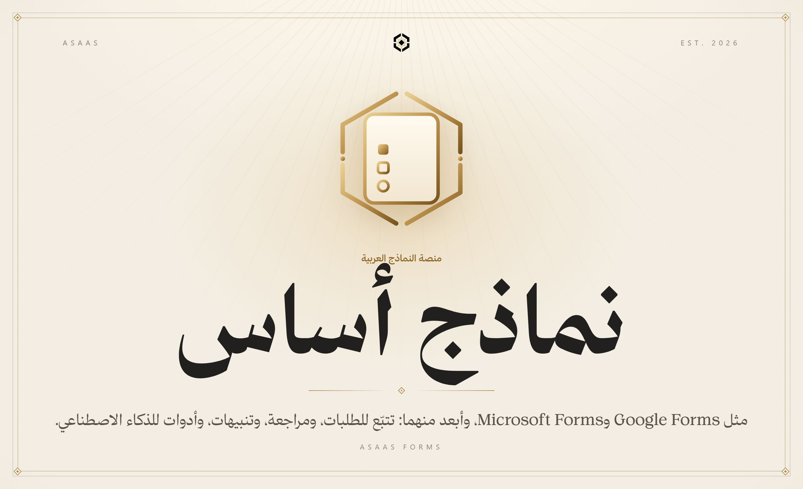

 

منصة نماذج عربية أولًا، تعمل مثل Google Forms وMicrosoft Forms وتذهب أبعد: تتبّع للطلبات برمز سري، ومراجعة بحالات وسجل، وتنبيهات بالبريد، وخادم MCP يتيح لمساعدات الذكاء الاصطناعي إنشاء النماذج وقراءة الردود. وكل إجابة يتحقق منها الخادم وكل درجة يحسبها هو، وتعمل من داخل أكاديمية أساس أيضًا.

 

<b>الكود في مستودع خاص</b> هذه واجهة العرض العامة لـ«نماذج أساس». الكود المصدري محفوظ في مستودع خاص، والمساهمة فيه متاحة بدعوة. <a href="https://alaadin-alynaey.site/">تواصل لطلب الوصول أو المساهمة</a>

 

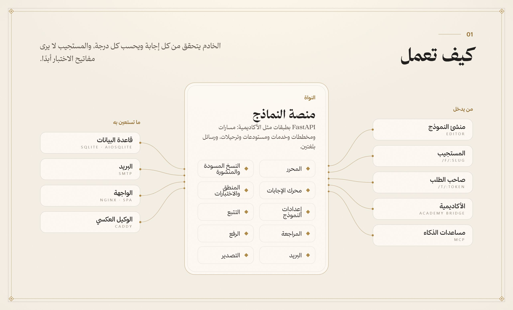

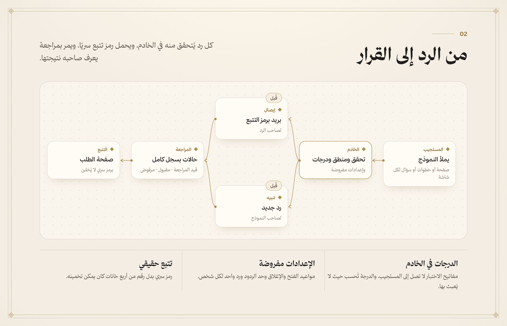

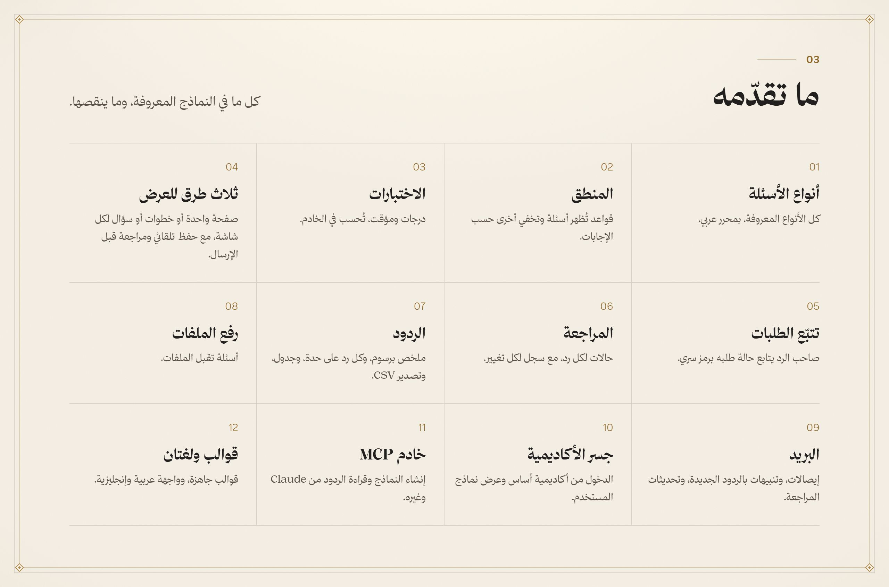

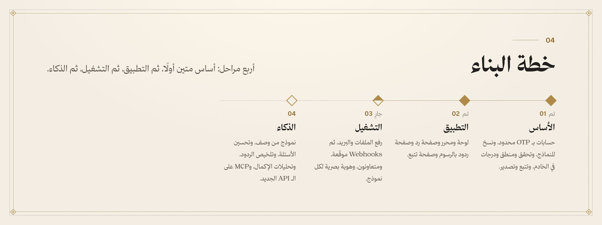

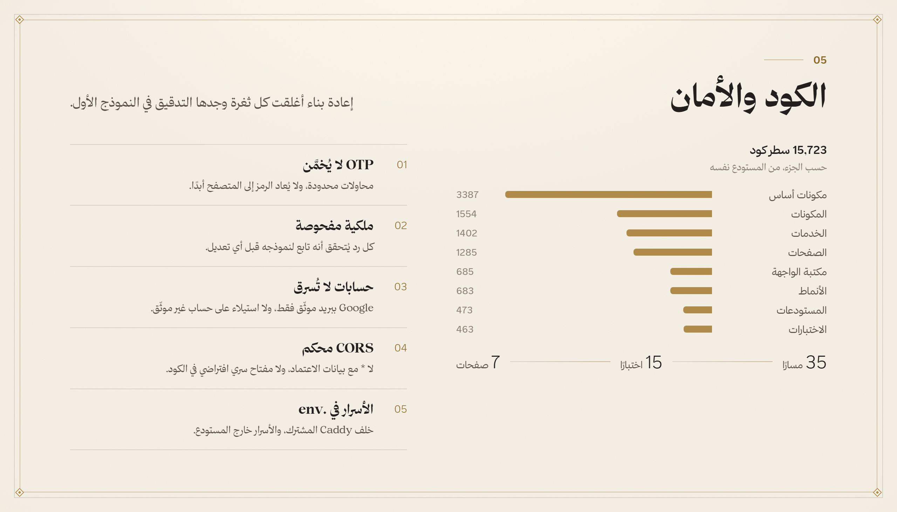

<a href="#arabic">العربية</a> · <b>English</b>

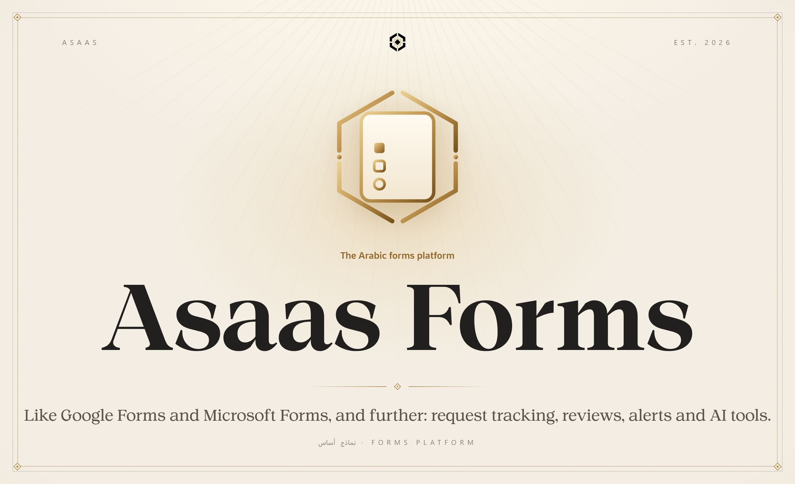

 

An Arabic-first forms platform that works like Google Forms and Microsoft Forms and goes further: request tracking with a secret token, reviews with statuses and history, email alerts, and an MCP server that lets AI assistants create forms and read responses. The server validates every answer and computes every score, and it works from inside Asaas Academy too.

 

<b>The source lives in a private repository</b> This is the public showcase of Asaas Forms. The source code is kept private, and contributions are open by invitation. <a href="https://alaadin-alynaey.site/">Get in touch for access or to contribute</a>

 

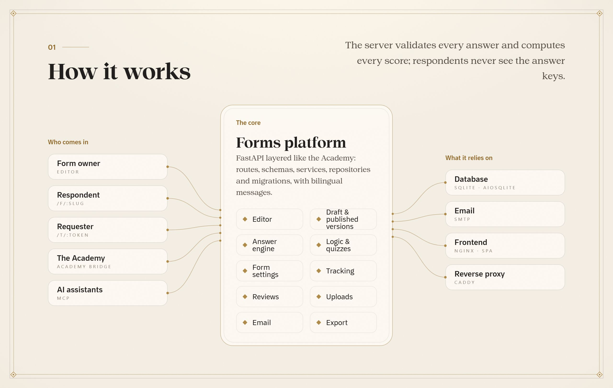

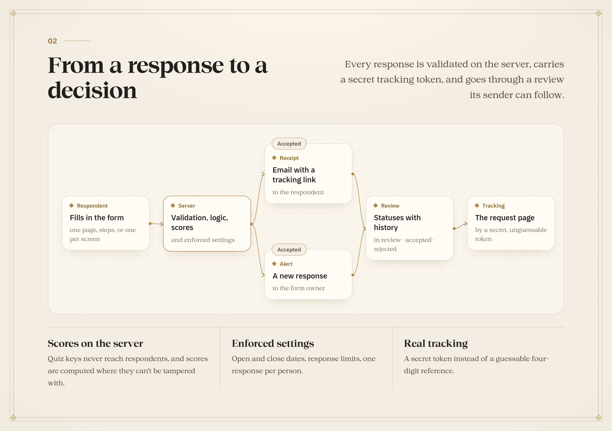

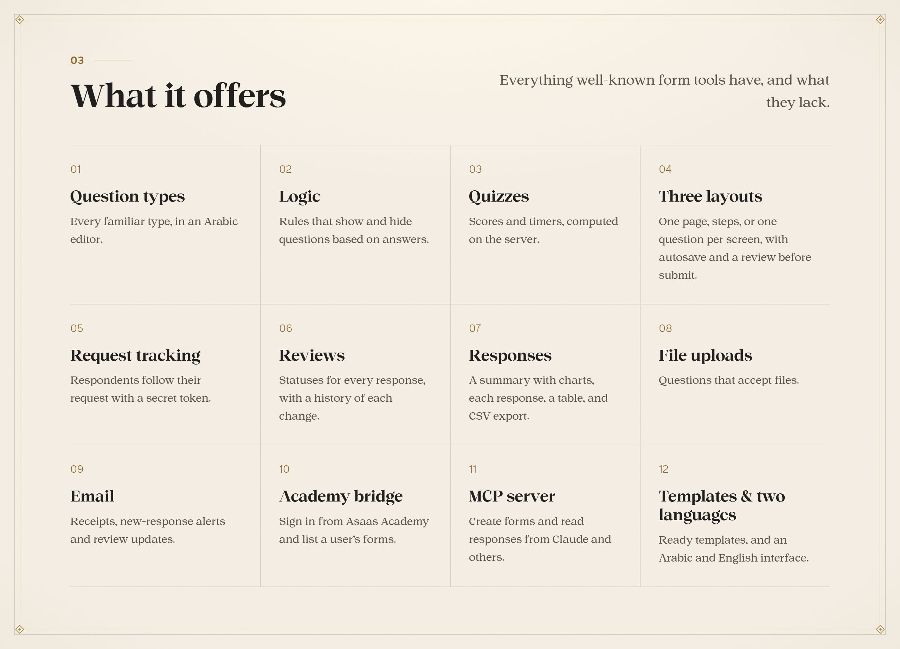

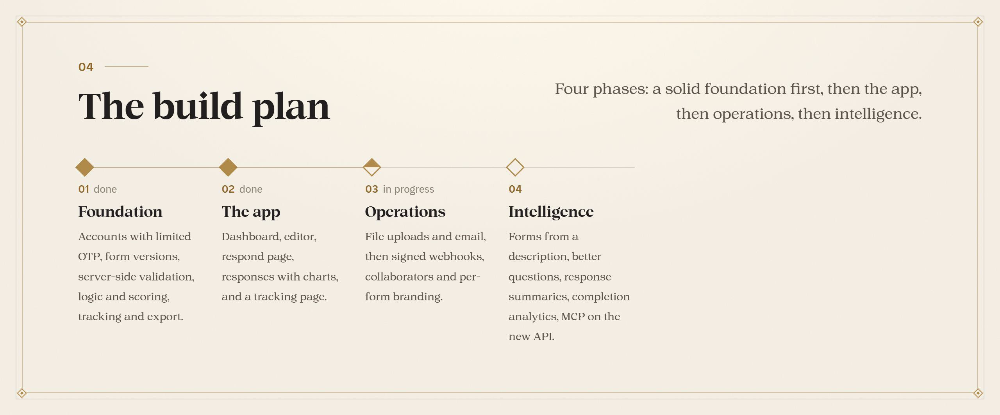

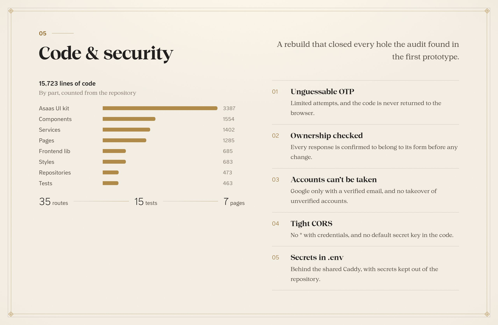

  جزء من منظومة <b>أساس</b> · Part of the <b>Asaas</b> ecosystem
   
  من تصميم وبناء <a href="https://github.com/AladdinAlynaey">علاء الدين اليناعي</a> · Designed and built by <a href="https://github.com/AladdinAlynaey">Alaadin Alynaey</a>
   
  © 2026 · جميع الحقوق محفوظة · All rights reserved

